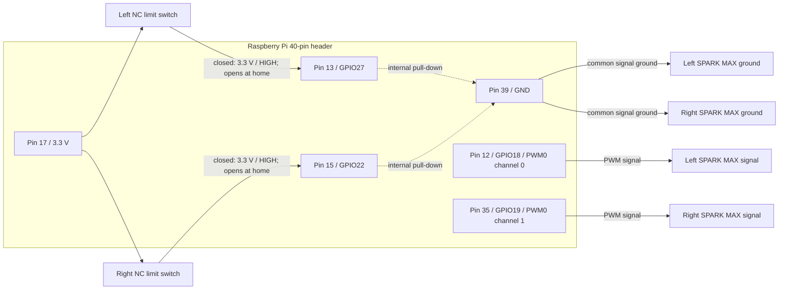

# Raspberry Pi GPIO wiring layout

This layout uses the standard 40-pin Raspberry Pi header numbering. The physical header pins and BCM GPIO numbers are different: use the **BCM GPIO** values in `config/default.json`; use the **physical pin** values to locate pins on the header.

## Pin assignments

| Function | Physical header pin | BCM GPIO | Connect to |
| --- | ---: | ---: | --- |
| Left SPARK MAX PWM signal | 12 | GPIO18 / PWM0 channel 0 | Left controller PWM signal wire |
| Right SPARK MAX PWM signal | 35 | GPIO19 | Right controller PWM signal wire |
| Left home limit input | 13 | GPIO27 | Left normally-closed switch output |
| Right home limit input | 15 | GPIO22 | Right normally-closed switch output |
| 3.3 V switch supply | 17 | 3V3 | Feed to the common contact side of both switches |
| PWM/signal ground | 39 | GND | Ground wires for both SPARK MAX PWM leads |

The matching application configuration is:

```text
left:  pwm_pin=18, pwm_channel=0, limit_pin=27, home_active_level=LOW
right: pwm_pin=19, pwm_channel=1, limit_pin=22, home_active_level=LOW
```

The application writes 20 ms periods (50 Hz) and configurable 1000–2000 µs duty pulses through Linux kernel PWM sysfs on `/sys/class/pwm/pwmchip0`. This setup requires the `pwm-2chan` device-tree overlay and two exposed channels. The overlay maps GPIO18 to PWM channel 0 and GPIO19 to PWM channel 1 on this Raspberry Pi 4 setup.

Enable the overlay in `/boot/firmware/config.txt`:

```ini
[all]
dtoverlay=pwm-2chan
```

Reboot, then verify `/sys/class/pwm/pwmchip0/npwm` reports `2` and `pinctrl get 18` / `pinctrl get 19` show the PWM alternate function. Do not start the motor application if those checks fail. The application needs permission to export and write PWM sysfs channels; run it with appropriate privileges.

## Signal layout



## Wiring and safety notes

- Connect physical pin 17 (3.3 V) to one side of each normally-closed switch. Connect the other side of the left switch to physical pin 13 (GPIO27), and the other side of the right switch to physical pin 15 (GPIO22). Configure the switch so its NC contact opens when the arm reaches home. gpiozero enables an internal pull-down for the LOW-active input: closed switch reads HIGH; open-at-home reads LOW.
- Connect physical pin 12 / GPIO18 to the left SPARK MAX **PWM signal**, and physical pin 35 / GPIO19 to the right SPARK MAX **PWM signal**. Keep the two signal wires separate. Connect both PWM lead ground wires to physical pin 39.
- Verify the SPARK MAX accepts the Pi's 3.3 V PWM logic level and that its signal ground can be shared with the Pi before connecting. Do not connect a motor-power lead to a Pi GPIO or Pi ground.
- Physical pin 17 is a **3.3 V supply**, not a GPIO output. Never connect the Pi's 5 V supply to these GPIO inputs.
- With this normally-closed passthrough wiring, an open switch or broken wire both read LOW and intentionally have the same behavior. During startup homing, LOW is treated as already at home. During normal preset operation, LOW is an unexpected limit fault: both motors stop, the controller waits, backs off the indicated arm while the input releases, then re-homes. A persistent broken wire stays LOW, so recovery times out and stops rather than continuing motion.
- - The arms should not normally contact their limit switches during preset movement; configure timed travel with clearance. The switches and wiring fault signal are intended as a fault response, not routine position control.
- The kernel PWM driver keeps its last pulse active if the application crashes or is forcibly terminated. Graceful shutdown commands neutral, but is not an emergency stop; keep motor power disconnected during wiring checks and provide an independent way to cut motor power before any powered test.
- Confirm the physical pin numbering against the exact Raspberry Pi board and header before applying power. The BCM assignments used here correspond to physical pins 12=GPIO18, 13=GPIO27, 15=GPIO22, 17=3.3 V, 35=GPIO19, and 39=GND on the standard 40-pin header.
- Test the wiring first with motor power disconnected. PWM pulses away from 1500 µs command motion once the SPARK MAX and motor are powered.
